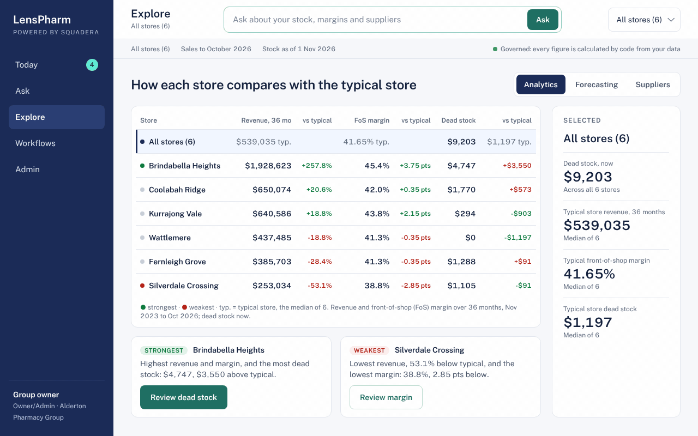
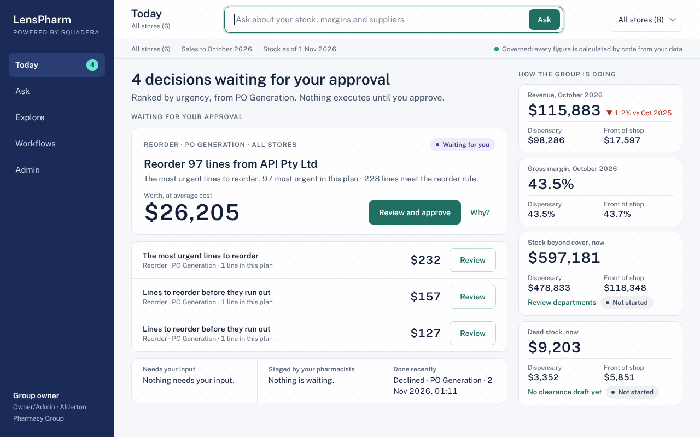
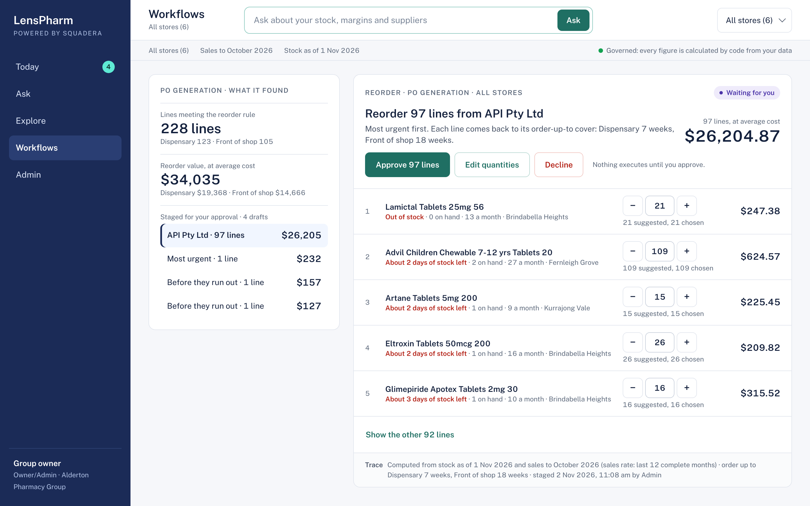
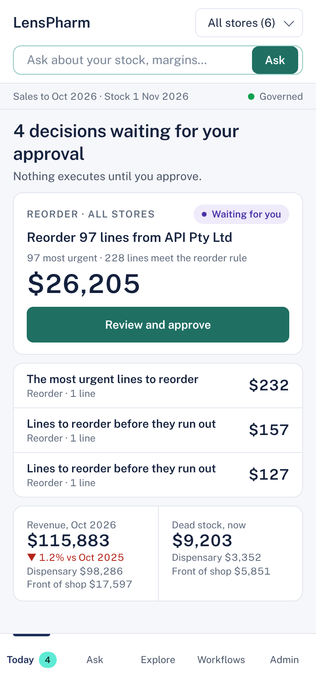
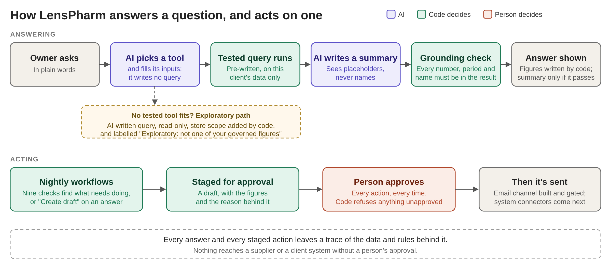
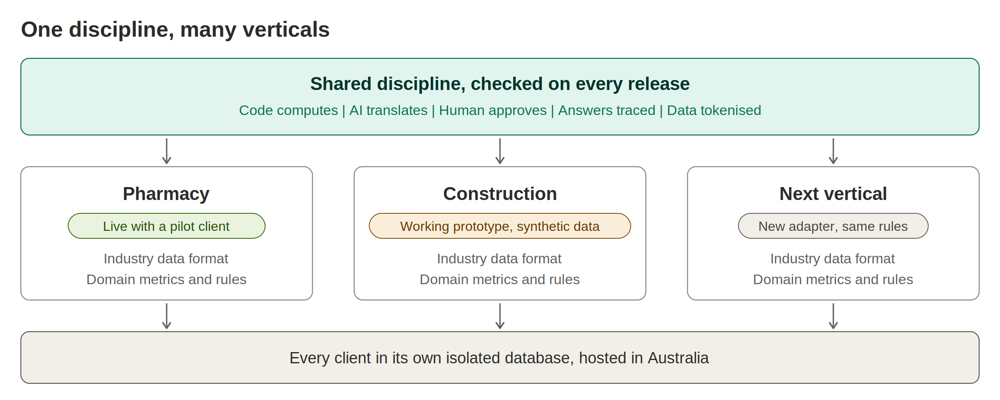
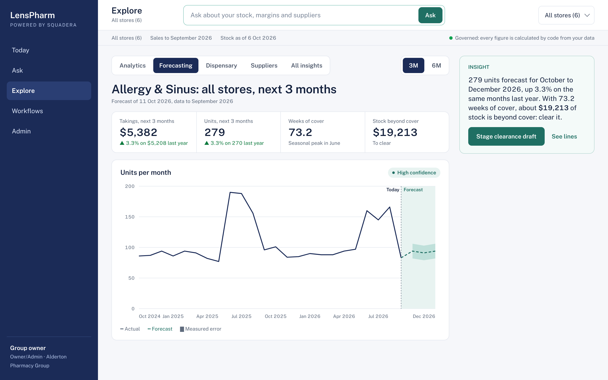

# LensPharm

**Trusted answers and staged actions for multi-store pharmacy groups.**

LensPharm is the first vertical of [Squadera](https://squadera.io), an AI operational intelligence platform for Australian multi-site businesses. It is live with a pilot client: a multi-store Australian pharmacy group.

Built by **Sonny Trikha**, Product Lead and Co-Founder, Squadera. [LinkedIn](https://linkedin.com/in/sonnytrikha)

> The source code is private because it serves a live client. This page covers the problem, the product, the architecture, the evidence and the decisions behind it. Images are product designs using figures from a synthetic demo tenant; no client data is shown. I'm happy to walk through a live demo on that tenant.

**On this page:** [The problem](#1-the-problem) · [The product](#2-the-product) · [The architecture](#3-the-architecture) · [The evidence](#4-the-evidence) · [The decisions](#5-the-decisions)

---

## 1. The problem

Pharmacy groups running several stores hold years of sales, stock, purchasing and rebate data, spread across systems that don't talk to each other. Owners can't afford a data team, can't wait weeks for a report, and don't trust a dashboard they can't check.

So margin leaks quietly: stock that stopped selling, rebates nobody chased, prices drifting outside target, and spend concentrated with one supplier without anyone noticing.

## 2. The product

One view across every store, each compared with the typical store, with the strongest and weakest called out and an action against each.

- **Ask.** An owner asks a question in plain words and gets an answer in seconds, with every figure traceable to its source and a short "How this was answered" trail underneath.
- **Workflows.** Nine operational workflows (purchase orders, rebate chasing, dead stock, supplier concentration, pricing, department margin, seasonal demand and more) check the data each night and stage recommended actions.
- **Approvals.** Nothing leaves the platform until a person approves it.

Every answer shows what it was computed from: the data, the period and the definition used, plus a way to flag it as helpful or incorrect. A recommendation becomes a draft for approval, never an action on its own.

The same decisions work on a phone, so an owner can approve from the shop floor.

## 3. The architecture

The model is an interpreter, not an oracle. It picks a tested tool and fills in its inputs, then puts the result into words. Every number, filter and comparison in between is computed by code against the client's own data. Questions no tested tool covers take a separate exploratory path, and the answer is labelled as exploratory so the owner knows it isn't one of their governed figures.

The same design carries to other industries: one standard data format per industry, a thin adapter per source system, and the same rules for how numbers are computed, worded and approved. A second vertical, [LensCon](https://github.com/sonny-stack/lenscon-case-study), applies it to multi-entity building groups.

**Stack:** Python and FastAPI, React, a separate DuckDB database per client, on AWS in Sydney. Claude through a provider layer, with credentials kept off the application host. Built with two AI coding agents: one builds, the other independently verifies, releases and deploys. Deploys, anything client-facing and priorities stay with me.

## 4. The evidence

Two questions, always together: **is it right, and is it used.**

| What is checked | How |
|---|---|
| How many real questions the tested path answers | 154 questions owners actually asked, replayed against production settings: **66% answered on the governed path**. I published that figure after discarding a flattering earlier sample, and it now sets the build order. |
| The summary doesn't invent anything | A grounding check confirms every number, period and name in the AI's summary appears in the result. If anything fails, the summary is dropped, the figures still show, and the drop is recorded. |
| The AI never sees client names | Names become placeholders before every model call. A check at the edge of the system blocks any placeholder from reaching the screen. |
| No action without approval | The code that sends refuses any action not marked approved. The email channel stays in dry-run until it is deliberately switched on for a client. |
| Fixes are real | A fix counts as done only when it is shown working on production for the exact case reported, with every screen that displays that value checked. |
| Problems show up as patterns | Defects are logged with a fixed severity vocabulary, so recurring issues surface as patterns rather than anecdotes. |

Forecasts carry their measured error, so the owner sees how far to trust the line before acting on it.

## 5. The decisions

| Decision | Why | What it cost |
|---|---|---|
| Code computes every number; AI only translates and words | An AI-written query can be fluent and wrong | Some questions are refused rather than guessed |
| AI chooses from pre-written, tested tools | Removes a whole class of error by construction | Fewer question shapes, each one provable |
| Keep an exploratory path, but label it | Owners still get help on new questions, honestly marked | Two standards of answer to explain |
| Client data is tokenised before any model call | The model never sees names or identifying values | More work to rebuild exactly what the owner saw |
| Every client has its own database | Regulated data stays separated by design | Higher operating cost per client |
| A person approves every action | A busy owner should never act on an unchecked recommendation | Slower than full automation, deliberately |
| Every answer and staged action leaves a trace | You can only improve what you can see | Engineering and storage effort up front |

## What's next

- A live connection to the pharmacy's point-of-sale and dispensing system, replacing exports
- Approved actions executing through connectors into client systems
- Deeper product-level answers and seasonal forecasting
- Onboarding the next client

---

*Squadera Pty Ltd, Sydney. [squadera.io](https://squadera.io)*
