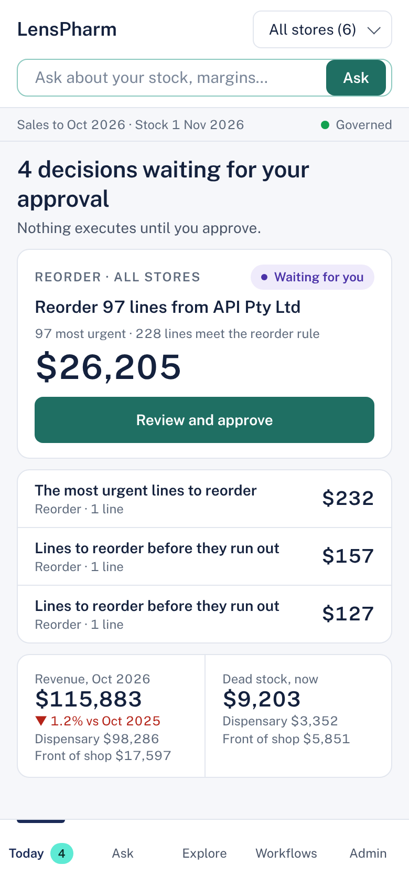

LensPharm

Trusted answers and staged actions for multi-store pharmacy groups.

LensPharm is the first vertical of Squadera, an AI operational intelligence platform for Australian multi-site businesses. It is live with a pilot client: a multi-store Australian pharmacy group.

Built by Sonny Trikha, Product Lead and Co-Founder, Squadera. LinkedIn

The source code is private because it serves a live client. This page explains what the product does, the decisions behind it, and how it is measured. I'm happy to walk through a live demo on a synthetic tenant.

The problem

Pharmacy groups running several stores hold years of sales, stock, purchasing and rebate data, spread across systems that don't talk to each other. Owners can't afford a data team, can't wait weeks for a report, and don't trust a dashboard they can't check.

So margin leaks quietly: stock that stopped selling, rebates nobody chased, prices drifting outside target, and spend concentrated with one supplier without anyone noticing.

LensPharm gives the owner one view across every store, each compared with the typical store, with the strongest and weakest called out and an action against each.

Every store compared with the typical store

What it does
Ask. An owner asks a question in plain words and gets an answer in seconds, with every figure traceable to its source and a short "How this was answered" trail underneath.
Workflows. Nine operational workflows (purchase orders, rebate chasing, dead stock, supplier concentration, pricing, department margin, seasonal demand and more) check the data and stage recommended actions.
Approvals. Nothing is written back to a client system until a person approves it.

An owner asks a question and gets a checkable answer

Every answer shows what it was computed from: the data, the period and the definition used, plus a way for the owner to flag it as helpful or incorrect. The recommendation becomes a draft for approval, never an action on its own.

A staged reorder waiting for the owner's approval

A workflow shows what it found, stages the actions with their values, and waits for the owner to approve, edit or decline. The trace line records exactly what it was computed from and when.

The same decisions work on a phone, so an owner can approve from the shop floor.

How it works

How LensPharm answers a question

The model is an interpreter, not an oracle. It turns the question into a request for a governed tool, and it puts the result into words. Everything in between, every number, filter and comparison, is computed by tested code against the client's own data.

The decisions behind it
Decision	Why	What we traded for it
Code computes every number; AI only translates and words	An AI-written query can be fluent and wrong	Some questions are refused rather than guessed
AI chooses from a registry of pre-written, tested tools	Removes a whole class of error by construction	Fewer question shapes, each one provable
Client data is tokenised before any model call	The model never sees names or identifying values	More work to rebuild exactly what the owner saw
Every client has its own isolated database	Regulated data stays separated by design	Higher operating cost per client
A person approves every action	A busy owner should never act on an unchecked recommendation	Slower than full automation, deliberately
A standard data format per industry, with a thin adapter	A new vertical reuses the discipline, not only the code	Each vertical still needs its own domain rules
Every answer and staged action leaves a trace	You can only improve what you can see	Engineering and storage effort up front
Built to grow

One discipline, many verticals

A second vertical, construction intelligence for multi-entity building groups, was built as a working prototype on the same discipline using synthetic Xero-format and Buildxact-format data. The lesson was useful: what carried across cleanly was the discipline, not the code. That is why the rules are written down once and checked on every release.

How it's measured

Two questions, always together: is it right, and is it used.

Coverage on real questions. Questions owners actually asked are replayed against production configuration to see how many the governed path answers. On 154 real questions, 66% were answered on the governed path, and that figure now sets the build order.
Defects are logged with a severity vocabulary, so recurring problems show up as patterns rather than anecdotes.
A fix counts as done only when it is shown working on production for the exact case reported, with every screen that displays that value checked.

A three-month forecast with its measured error band

Forecasts carry their measured error, so the owner sees how far to trust the line before acting on it. Here the insight turns the forecast into one decision: about $19,213 of stock sits beyond cover, with a clearance draft one click away for approval.

How it's built
Python and FastAPI, React, DuckDB per client, on AWS in Sydney
Claude through a provider layer, with credentials kept off the application host
Built with two AI coding agents: one builds, the other independently verifies, releases and deploys. Deploys, anything client-facing and priorities stay with me.

Images are product designs using figures from a synthetic demo tenant. No client data is shown.

What's next
A live connection to the pharmacy's point-of-sale and dispensing system, replacing exports
Approved actions executing through connectors into client systems
Deeper product-level answers and seasonal forecasting
A design refresh across the platform, and onboarding the next client

Squadera Pty Ltd, Sydney. squadera.io
